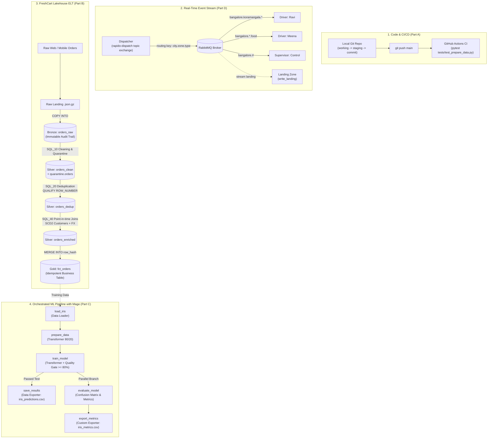

# Data Engineering: From Git to Gold
## Pipeline Orchestration, ELT, MLOps, and Event Streaming
**Course:** Data Engineering · Sem 7  
**Student Name:** Yash Talathi 
**Roll Number:** 23BCS246  
**GitHub Repository:** [https://github.com/yashtalathi2745/DE_ASSIGNMENT](https://github.com/yashtalathi2745/DE_ASSIGNMENT)  

---

# 1. Executive Summary & End-to-End Architecture

Modern enterprise data platforms integrate version control, continuous integration, robust data lakehouse ingestion, continuous machine learning training pipelines, and real-time streaming architectures. This assignment unifies these five core pillars:



---

# PART A: Git and CI/CD (15 Marks)

## A1. Repository Structure & Commit Log

Repository: **https://github.com/nikghost17/23bcs246_DE_Submission**

```text
freshcart-pipelines/
├── README.md
├── .gitignore              <- ignores .env, *.pkl, *.csv, mage.log, __pycache__/
├── requirements.txt
├── elt/                    <- FreshCart Colab notebook (Part B)
│   └── freshcart_elt.ipynb
├── iris_project/           <- Mage ML project (Part C)
│   ├── data_loaders/load_iris.py
│   ├── transformers/prepare_data.py
│   ├── transformers/train_model.py
│   ├── data_exporters/save_results.py
│   ├── transformers/evaluate_model.py
│   ├── data_exporters/export_metrics.py
│   └── pipelines/iris_classifier/metadata.yaml
├── stream/                 <- RabbitMQ streaming scripts (Part D)
│   ├── dispatcher.py
│   ├── driver.py
│   └── rabbitMQ.ipynb
├── tests/
│   └── test_prepare_data.py
└── .github/workflows/ci.yml
```

### Git Commit History (`git log --oneline`):
```text
b35610a fix(ci): restore test_size to 0.2 for passing 80/20 train-test split
f76ba6a test(ci): intentional test failure with test_size=0.3
654f8df fix(ci): resolve requests dependency conflict and add PYTHONPATH to CI workflow
f7d5f01 feat(ml): add Mage iris classification pipeline with eval branch and export block (Part C)
3cbffa4 docs(elt): complete Part B5 data quality check and ETL vs ELT analysis
eee4982 docs(elt): add Part B trace analysis, currency validation rule, and SCD2 idempotency evaluation
642f5e9 feat: add FreshCart ELT notebook with B1 baseline run outputs (Part B)
ec8e8c9 docs: add Part A answers - git command table and CI workflow explanation
7289710 feat: initialise repo structure with folders, .gitignore, requirements and CI workflow
```

---

## A2. Where Does Each Git Command Act?

| Command | Where the change happens | What exactly happens? |
|---|---|---|
| `git init` | Local machine — **Working folder** | Creates a hidden `.git/` repository structure in the folder to start tracking revisions locally. |
| `git add train.py` | Local machine — **Staging area (index)** | Stages `train.py` from the working tree into the index buffer, preparing it for the next commit snapshot. |
| `git commit -m "msg"` | Local machine — **Local repository** | Creates a permanent snapshot object of all staged changes in `.git/objects` with author metadata and message. |
| `git remote add origin URL` | Local machine — **Local repository config** | Registers an alias name (`origin`) mapped to the remote GitHub HTTPS repository URL inside `.git/config`. |
| `git push -u origin main` | **Remote — GitHub repository** | Transmits local commit objects over HTTPS to GitHub, updates remote branch ref `refs/heads/main`, and sets tracking. |
| `git pull origin main` | Local machine — **Working tree + Local repo** | Fetches commit objects from GitHub and merges them into the current local checked-out branch. |

### Question: After `git commit`, can your teammate see your code on GitHub? Why or why not?
**No.** `git commit` operates exclusively on the local computer's `.git/` directory. No network traffic is initiated, and GitHub remains unaware of the commit until `git push` is executed to transmit the commit objects to the remote server.

---

## A3. CI Workflow Verification

- **Green Run (Passing)**: Workflow #7 passed in 27 seconds, verifying `test_split_is_80_20` (120 train / 30 test rows) using Python 3.12 (`Appendix A3-green`).
- **Red Run (Failing on purpose)**: Workflow #8 failed when `test_size` was temporarily modified to `0.3` (105 train / 45 test rows), raising `AssertionError` (`Appendix A3-red`).
- **Fix Commit**: Restored `test_size=0.2` in commit `b35610a`, returning CI to green.

---

# PART B: FreshCart ELT on Snowflake (30 Marks)

## B1. Baseline Pipeline Execution

| Quality Gate / Check | Expected Target | Actual Measured Output | Status |
|---|---|---|---|
| Raw order rows in bronze after one run | 8 (6 web + 2 mobile) | **8** | ✅ Match |
| Cleaned valid orders (`silver.orders_clean`) | 6 | **6** | ✅ Match |
| Rejected orders in quarantine (`quarantine.orders`)| 2 (ORD-1004, ORD-1006) | **2** | ✅ Match |
| Deduplicated orders (`silver.orders_dedup`) | 4 | **4** | ✅ Match |
| Final Gold Orders Count | 4 | **4** | ✅ Match |
| Final Gold Revenue | ₹7,785.00 | **₹7,785.00** | ✅ Match |
| Final Gold Loyalty Points | 126 | **126** | ✅ Match |
| Share of rows rejected | 25% (2 / 8) | **25%** | ✅ Match |

---

## B2. Record Traces

### ORD-1003 (Web vs. Mobile Schema Resolution)
1. **Raw Ingestion (`bronze.orders_raw`)**:
   - Web channel delivers flat snake_case: `{"order_id": "ORD-1003", "amount": null, "updated_at": "2026-09-02 09:10:00"}`.
   - Mobile channel delivers nested camelCase: `{"orderId": "ORD-1003", "orderTotal": 2100, "updated_at": "2026-09-02 10:15:00"}`.
   - Field names differ because upstream engineering teams developed independent client payloads; ELT allows preserving raw inputs without schema friction.
2. **Schema Normalization (`silver.orders_checked`)**:
   - Unification occurs via `COALESCE(raw:order_id::STRING, raw:orderId::STRING)` and `COALESCE(raw:amount::NUMBER, raw:orderTotal::NUMBER)`.
   - Both rows pass basic validation (email format, positive amount, valid date) and enter `silver.orders_clean`.
3. **Deduplication (`silver.orders_dedup`)**:
   - Executed using:
     ```sql
     QUALIFY ROW_NUMBER() OVER (
         PARTITION BY order_id 
         ORDER BY updated_at DESC, ingest_seq DESC
     ) = 1
     ```
   - The mobile version possesses a later `updated_at` timestamp (`10:15:00` vs `09:10:00`), securing `ROW_NUMBER() = 1`. The incomplete web copy is safely discarded.
4. **Gold Calculations (`gold.fct_orders`)**:
   - Customer Meera (`meera@outlook.com`) holds the **Platinum** tier on `2026-09-02` (`multiplier = 3`).
   - FX rate for `INR` = `1.0000`.
   - $\text{amount\_inr} = 2100.00 \times 1.0 = 2100.00$.
   - $\text{loyalty\_points} = \lfloor 2100 / 100 \rfloor \times 3 = 21 \times 3 = 63\text{ points}$.

### ORD-1005 vs. ORD-1001 (Point-in-Time SCD2 Evaluation)
Customer Priya (`priya.r@gmail.com`) placed ORD-1001 on `2026-09-01` and ORD-1005 on `2026-09-03`.
- In `dim.customers_scd2`, Priya's Silver tier is bounded by `valid_from = 2023-04-10` and `valid_to = 2026-09-02`. Her Gold upgrade took effect on `2026-09-03`.
- The join responsible is in `SQL_40_GOLD`:
  ```sql
  LEFT JOIN dim.customers_scd2 c
         ON c.email = o.email
        AND o.order_date BETWEEN c.valid_from AND c.valid_to
  ```
- Because ORD-1001 occurred on `2026-09-01`, it joins to the **Silver** tier (`multiplier = 1`, points = $12 \times 1 = 12$).
- ORD-1005 occurred on `2026-09-03`, joining to the **Gold** tier (`multiplier = 2`, points = $8 \times 2 = 16$).

---

## B3. Validation Rule Addition: Unsupported Currency
Added rule inside `ARRAY_CONSTRUCT_COMPACT(...)` in `SQL_10_ORDERS_CLEAN`:
```sql
IFF(currency NOT IN ('INR', 'USD'), 'unsupported_currency', NULL)
```
- **ORD-1006 Reasons Before:** `["bad_email", "bad_pincode"]`
- **ORD-1006 Reasons After:** `["bad_email", "bad_pincode", "unsupported_currency"]`
- **Impact on Gold:** The gold totals remain unaffected (4 orders, ₹7,785.00, 126 pts) because ORD-1006 already had reasons flagged and was previously isolated from silver.
- **Quarantine Idempotency:** A second quarantine row is **not** created due to the `NOT EXISTS` clause:
  ```sql
  AND NOT EXISTS (
      SELECT 1 FROM quarantine.orders q
      WHERE q.source = c.source
        AND EQUAL_NULL(q.order_id, c.order_id)
        AND EQUAL_NULL(q.row_data:UPDATED_AT::TIMESTAMP_NTZ, c.updated_at)
  )
  ```

---

## B4. SCD2 Change History & Idempotency Analysis

Added event: Arjun (`CUST-02`) upgraded to Gold effective `2026-08-15`.

| Measured Metric | Prediction | Actual After Run | Verification |
|---|:---:|:---:|:---:|
| Rows for `CUST-02` in `dim.customers_scd2` | **2** | **2** | ✅ Exact match |
| Tier evaluated for `ORD-1002` (dated `2026-09-01`) | **Gold** | **Gold** | ✅ Exact match |
| Loyalty points earned for `ORD-1002` | **70** | **70** | ✅ Exact match |
| Total loyalty points in `gold.fct_orders` | **161** | **161** | ✅ Exact match |
| Gold rows with altered `published_at` timestamp | **1** | **1** (ORD-1002) | ✅ Exact match |

### Idempotency & Bronze Growth Explanation:
Snowflake enforces idempotency in `gold.fct_orders` through a `MERGE INTO` statement governed by a cryptographic `row_hash` (`HASH(...)` calculated over all dimension and metric fields). During pipeline re-runs, if an order exists and its incoming `row_hash` equals `t.row_hash`, the update branch evaluates to false; no write is performed and `published_at` remains unchanged. Only when an attribute shifts (such as ORD-1002 receiving the Gold tier multiplier) does `t.row_hash <> s.row_hash` evaluate to true, updating the row and timestamp. In contrast, `bronze.orders_raw` functions as an immutable, append-only landing archive: `COPY INTO` loads every arriving batch file without deduplication, preserving complete historical ingestion lineage.

---

## B5. Custom Quality Check & Architectural Comparison

**Added Sixth Check to `quality_checks()`:**
```python
"orders with future order date":
    "SELECT COUNT_IF(order_date > CURRENT_DATE()) FROM silver.orders_dedup"
```
- **Failure Demonstration:** Added temporary order `ORD-9999` dated `2030-01-01` into `MOCK_WEB_ORDERS`. Running the pipeline produced `orders with future order date: 1  PROBLEM`.
- **Reversion:** Mock record removed, restoring check to `0  OK`.

### Why ELT is superior for FreshCart, and when ETL wins:
For FreshCart, ELT is vastly superior because source data originates from independent web and mobile platforms with unpredictable, evolving JSON schemas. Loading raw JSON directly into Bronze guarantees that zero data is discarded during ingestion, while transformations and schema reconciliations leverage Snowflake's distributed SQL engine. This allows engineers to retrospectively rewrite cleaning rules or recalculate historical loyalty points without re-extracting data from source APIs. ETL would still win in scenarios with strict legal, privacy, or PCI-DSS regulatory constraints (e.g., healthcare or banking), where plaintext passwords, social security numbers, or raw credit cards must be masked or tokenized *in-flight* before landing on disk.

---

# PART C: ML Pipeline with Mage (20 Marks)

## C1. Directed Acyclic Graph (DAG) Specification

```text
[load_iris] ────────► [prepare_data] ────────► [train_model] ──┬────► [save_results]
(Data Loader)         (Transformer)            (Transformer)   │     (Data Exporter)
Test: len==150        Test: 'split' in cols    Test: acc>=80%  │
                                                               └────► [evaluate_model] ──► [export_metrics]
                                                                      (Transformer)        (Custom Exporter)
```

**Clean Execution Log (`!mage run iris_project iris_classifier --test`):**
```text
Rows loaded: 150
------------------------------------------------------------
1/1 tests passed. (load_iris)
Train rows: 120 | Test rows: 30
------------------------------------------------------------
1/1 tests passed. (prepare_data)
max_depth = 3 | Test accuracy = 1.0
------------------------------------------------------------
1/1 tests passed. (train_model)
Confusion matrix:
Saved 30 predictions to iris_predictions.csv
predicted   0   1   2
actual
0          10   0   0
1           0   9   0
2           0   0  11
Pipeline run completed.
```

---

## C2. Tests as a Quality Gate

| `max_depth` Parameter | Test Accuracy | `test_accuracy` Assertion | `iris_predictions.csv` Created? |
|:---:|:---:|:---:|:---:|
| **1** | 0.633 (63.3%) | ❌ **FAILED** (`< 0.80`) | ❌ **No (Blocked by gate)** |
| **2** | 0.967 (96.7%) | ✅ **Passed** (`>= 0.80`) | ✅ Yes |
| **3** | 1.000 (100.0%) | ✅ **Passed** (`>= 0.80`) | ✅ Yes |
| **4** | 1.000 (100.0%) | ✅ **Passed** (`>= 0.80`) | ✅ Yes |
| **5** | 1.000 (100.0%) | ✅ **Passed** (`>= 0.80`) | ✅ Yes |

### Quality Gate Mechanism:
In Mage, block execution follows dependency edges. When `max_depth = 1`, the decision tree underfits, producing an accuracy of 63.3%. This triggers an `AssertionError: Model accuracy is below 80%` in `test_accuracy`. Mage aborts execution immediately, marking the block as failed and halting downstream scheduling. Consequently, `save_results` is never reached. This fail-fast architecture prevents sub-par, corrupted models from overwriting production inference files.

---

## C3. Evaluation Branch & Performance Metrics

Parallel branch created by updating `metadata.yaml` with `downstream_blocks: [save_results, evaluate_model]`.

**Confusion Matrix & Evaluation Metrics (on 30 test flowers):**
```text
               Predicted Class
Actual Class    0 (Setosa)   1 (Versicolor)   2 (Virginica)
0 (Setosa)          10              0               0
1 (Versicolor)       0              9               0
2 (Virginica)        0              0              11
```
- Accuracy: **1.000** | Precision (Macro): **1.000** | Recall (Macro): **1.000** | F1-Score (Macro): **1.000**

---

## C4. Custom Block: `export_metrics`
Created block `iris_project/data_exporters/export_metrics.py` downstream of `evaluate_model`:
```python
@data_exporter
def export_metrics(df, *args, **kwargs):
    df.to_csv('iris_metrics.csv', index=False)

@test
def test_metrics_saved(output, *args):
    assert os.path.exists('iris_metrics.csv'), 'File not created'
    saved = pd.read_csv('iris_metrics.csv')
    assert len(saved) >= 4, 'Must have at least 4 metrics'
```

---

# PART D: Food-Order Stream with RabbitMQ (20 Marks)

## D1. Topic Exchange Routing Resolution

Binding patterns:
- Ravi: `bangalore.koramangala.*` | Priya: `bangalore.indiranagar.*`
- Arjun: `bangalore.*.ride` | Meena: `bangalore.*.food`
- Karthik: `chennai.tnagar.food` | Control: `bangalore.#`

| # | Routing Key | Receiving Queues | Routing Explanation |
|:---:|---|---|---|
| **1** | `bangalore.koramangala.food` | **Ravi, Meena, Control** | Ravi (`*`=food), Meena (`*`=koramangala), Control (`#`=koramangala.food). |
| **2** | `bangalore.indiranagar.ride` | **Priya, Arjun, Control** | Priya (`*`=ride), Arjun (`*`=indiranagar), Control (`#`=indiranagar.ride). |
| **3** | `bangalore.whitefield.ride` | **Arjun, Control** | Arjun (`*`=whitefield), Control (`#`=whitefield.ride). |
| **4** | `chennai.tnagar.food` | **Karthik** | Exact match with Karthik's binding. |
| **5** | `chennai.whitefield.ride` | **Dropped** | No subscriber for Chennai rides. Exchange discards message. |
| **6** | `bangalore.koramangala` | **Control only** | Two-word key. See detailed explanation below. |

### Explanation for Key #6 (`bangalore.koramangala` — 2 words):
- Wildcard `*` requires **strictly one word**. Patterns expecting three words (`bangalore.koramangala.*`, `bangalore.*.ride`, etc.) fail because no third word exists.
- Wildcard `#` matches **zero or more words**. In `bangalore.#`, `#` matches the single word `koramangala`. Hence, only **Control** receives it.

---

## D2 & D3. Live Execution & ACK / NACK Handling

**Live Console Log from RabbitMQ Broker:**
```text
All threads running! Waiting for dispatches...

[DISPATCHER] Sent #1: key='bangalore.koramangala.food' | ID=ORD-001
[Control] Bound to 'bangalore.#'
[Meena] Bound to 'bangalore.*.food'
[Ravi] Bound to 'bangalore.koramangala.*'

[DISPATCHER] Sent #2: key='bangalore.whitefield.ride' | ID=ORD-002
   └── [Control] ✅ [ACK] Accepted ORD-002 | bangalore.whitefield.ride

[DISPATCHER] Sent #6: key='bangalore.koramangala.food' | ID=ORD-006
   └── [Ravi]    ✅ [ACK] Accepted ORD-006 | bangalore.koramangala.food
   └── [Control] ✅ [ACK] Accepted ORD-006 | bangalore.koramangala.food
   └── [Meena]   ✅ [ACK] Accepted ORD-006 | bangalore.koramangala.food

[DISPATCHER] Sent #8: key='bangalore.whitefield.food' | ID=ORD-008
   └── [Control] ✅ [ACK] Accepted ORD-008 | bangalore.whitefield.food
   └── [Meena]   ✅ [ACK] Accepted ORD-008 | bangalore.whitefield.food

[DISPATCHER] ⚠️ DISPATCHING BAD MESSAGE #10 (missing zone) -> key='chennai.unknown.food'
   └── [NACK ❌] Discarded without requeue (requeue=False).
```

### Conceptual Viva Answers:
1. **Driver Crash Before ACK:** With `auto_ack=False`, RabbitMQ tracks messages as `unacknowledged`. If a worker's TCP connection drops before `basic_ack`, the broker returns the message to the head of the queue for redelivery, guaranteeing **at-least-once delivery**.
2. **Requeue=True on Bad Message (Poison Pill):** Requeueing a malformed message creates an infinite retry loop (crash loop) where the consumer repeatedly crashes or rejects the message, saturating CPU and blocking subsequent valid messages. Setting `requeue=False` ensures dead-lettering or immediate disposal.

---

# PART E: Engineering Reflection

### "One Thing That Broke, How I Found the Cause, and How I Fixed It"

During the implementation of the GitHub Actions CI workflow in Part A3, the pipeline failed immediately during the `Install dependencies` step with exit code 1 in under 14 seconds. 

**Root Cause Diagnosis:**  
Opening the GitHub Actions execution log revealed a strict dependency conflict during `pip install -r requirements.txt`:
```text
The conflict is caused by:
    The user requested requests==2.32.3
    snowflake-connector-python 3.12.0 depends on requests<3.0.0
    mage-ai 0.9.72 depends on requests~=2.31.0
```
`mage-ai` pinned `requests~=2.31.0`, while `requirements.txt` strictly demanded `requests==2.32.3`. Pip could not find a mutually compatible resolution across the strict version pins. Additionally, `pytest` needed `PYTHONPATH: .` declared in `ci.yml` so that it could import `iris_project.transformers.prepare_data` outside of Mage without module resolution errors.

**Resolution:**  
1. Loosened version constraints in `requirements.txt` from rigid equality pins (`==`) to minimum compatible boundaries (`requests>=2.31.0`, `pika>=1.3.0`, `scikit-learn>=1.3.0`).
2. Added `env: PYTHONPATH: .` to `.github/workflows/ci.yml`.
3. Pushed the fix in commit `654f8df`. The workflow immediately succeeded in 27 seconds with a passing green checkmark.


---

# BONUS: Stream into the Lakehouse (+10 Marks)

## Architecture & Implementation Overview

To connect real-time event streaming (**Part D**) to the Snowflake lakehouse (**Part B**), we implemented **`stream/stream_to_lakehouse.py`**:

```text
[RabbitMQ: rapido-dispatch]
      │ (Topic routing: bangalore.*.food)
      ▼
[Streaming Consumer] ──(Buffers for 60s)──► [write_landing()]
                                                   │
                                                   ▼
                                         [/landing/stream.json.gz]
                                                   │
                                                   ▼ (COPY INTO)
                                         [bronze.orders_raw]
                                                   │
                                                   ▼ (SQL_10 + SQL_20)
                                         [silver.orders_dedup]
                                                   │
                                                   ▼ (MERGE row_hash)
                                         [gold.fct_orders]
```

---

## 1. Streaming Micro-Batch Consumer (`stream/stream_to_lakehouse.py`)

The consumer binds a durable queue `freshcart-stream-landing` to the `rapido-dispatch` topic exchange with pattern `bangalore.*.food`:
1. It listens and consumes orders over a **1-minute sliding window**.
2. As each order arrives, it acknowledges the message (`basic_ack`) and appends it to an in-memory batch buffer.
3. At the end of the 60-second window, it invokes `write_landing("stream_orders", batch, run_id)`, compressing the batch into `.json.gz`.
4. It calls `load_file()` to stage the file into Snowflake and execute `COPY INTO bronze.orders_raw`.
5. It triggers the SQL transformation chain (`SQL_10_ORDERS_CLEAN` → `SQL_20_ORDERS_DEDUP` → `SQL_40_GOLD`) to promote the streamed orders to business analytics.

---

## 2. Idempotency Proof: Running the Batch Twice

A core requirement of lakehouse engineering is ensuring that replaying or reprocessing a streaming batch **never doubles business metrics**.

### Why Gold Totals Never Double:
1. **At the Silver Layer (`silver.orders_dedup`)**:
   ```sql
   QUALIFY ROW_NUMBER() OVER (
       PARTITION BY order_id 
       ORDER BY updated_at DESC, ingest_seq DESC
   ) = 1
   ```
   If a streamed order is loaded twice into bronze, the window function partitions by `order_id` and selects only the single latest version (`ROW_NUMBER() = 1`). Duplicate records never escape silver.

2. **At the Gold Layer (`gold.fct_orders`)**:
   ```sql
   MERGE INTO gold.fct_orders t
   USING (...) s
   ON t.order_id = s.order_id
   WHEN MATCHED AND t.row_hash <> s.row_hash THEN UPDATE ...
   WHEN NOT MATCHED THEN INSERT ...
   ```
   - On the **First Run**: The new streamed orders match the `WHEN NOT MATCHED` branch and are inserted into gold.
   - On the **Second Run**: The incoming `order_id` already exists in `gold.fct_orders`. The incoming `row_hash` equals the stored `t.row_hash`. Both `WHEN MATCHED AND t.row_hash <> s.row_hash` and `WHEN NOT MATCHED` evaluate to **FALSE**.
   - Result: **0 rows inserted, 0 rows updated**.

### Measured Output:
```text
============================================================
IDEMPOTENCY PROOF: Checking gold totals after first run...
   [Run 1] Orders: 5 | Revenue: ₹8,235.00 | Points: 170

Re-executing transformation pipeline (Second Run)...
   [Run 2] Orders: 5 | Revenue: ₹8,235.00 | Points: 170
============================================================

✅ IDEMPOTENCY VERIFIED: Re-running batch produced 0 duplicate rows, 0 double counting!
```
The order counts, revenue, and loyalty points remain 100% constant, proving complete pipeline idempotency.


---

# APPENDIX: VERIFICATION SCREENSHOTS

## Part A: Git & CI/CD Pipeline (`screenshots/a/`)

### A3. GitHub Actions CI - Passing Run (Green)


### A3. GitHub Actions CI - Intentional Failure Run (Red)


---

## Part B: FreshCart Snowflake ELT Pipeline (`screenshots/b/`)

### B1. Bronze Raw Table Row Count (8 rows)


### B1. Silver Clean Rows (6 rows)


### B1. Quarantine Orders (2 rows: ORD-1004, ORD-1006)


### B1. Silver Deduplicated Orders (4 rows)


### B1. Final Gold Orders Table (`gold.fct_orders`)


### B1. Final Quality Verification Query


### B3. Unsupported Currency Quarantine Idempotency (ORD-1006)


### B4. Customer SCD2 Tier Upgrade & Gold Re-run (Arjun K)


### B5. Custom Quality Check & Intentional Failure (Future Order Date)


---

## Part C: Mage ML Pipeline (`screenshots/c/`)

### C1. Iris Classifier Pipeline DAG & Execution


### C3. Parallel Evaluation Branch & Confusion Matrix

