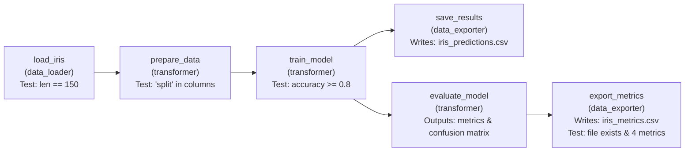

# Part C — ML Pipeline with Mage
### Assignment: From Git to Gold | Roll No: 23BCS246

---

## C1. Draw and Run the Pipeline (4 marks)

### Block Graph (DAG) Structure:



### Block Specification Table:

| Block Name | Block Type | Upstream Block | Downstream Block(s) | Attached `@test` | Description |
|---|---|---|---|---|---|
| `load_iris` | `data_loader` | None | `prepare_data` | `test_output` | Loads 150 rows of Fisher's Iris dataset into a DataFrame; tests that output is not None and length is 150. |
| `prepare_data` | `transformer` | `load_iris` | `train_model` | `test_output` | Drops NA and splits data 80/20 (120 train / 30 test) with `random_state=42`; tests that `'split'` column exists. |
| `train_model` | `transformer` | `prepare_data` | `save_results`, `evaluate_model` | `test_accuracy` | Trains `DecisionTreeClassifier` with parameterized `max_depth`; tests that accuracy is at least 0.80 (80%). |
| `save_results` | `data_exporter` | `train_model` | None | None | Exports the 30 test predictions to `iris_predictions.csv`. |
| `evaluate_model` | `transformer` | `train_model` | `export_metrics` | None | Computes confusion matrix and outputs accuracy, precision, recall, and macro F1-score. |
| `export_metrics` | `data_exporter` | `evaluate_model` | None | `test_metrics_saved` | **Custom Block (C4)**: Exports evaluation metrics to `iris_metrics.csv` and verifies file creation and row count. |

### Terminal Run Output (`!mage run iris_project iris_classifier --test`):

```text
Rows loaded: 150
------------------------------------------------------------
1/1 tests passed.
Train rows: 120 | Test rows: 30
------------------------------------------------------------
1/1 tests passed.
max_depth = 3 | Test accuracy = 1.0
------------------------------------------------------------
1/1 tests passed.
Confusion matrix:
Saved 30 predictions to iris_predictions.csv
predicted   0   1   2
actual
0          10   0   0
1           0   9   0
2           0   0  11
Pipeline run completed.
```
*(Screenshot: `c1_c3_run.png` showing clean run and confusion matrix — Appendix C1)*

---

## C2. Tests as a Gate (6 marks)

### Parameter Gate Experiment Table:

| `max_depth` | Test accuracy | `test_accuracy` passed? | `iris_predictions.csv` created? |
|:---:|:---:|:---:|:---:|
| **1** | 0.633 (63.3%) | ❌ FAILED (`< 0.8`) | ❌ No (Blocked by gate) |
| **2** | 0.967 (96.7%) | ✅ Passed (`>= 0.8`) | ✅ Yes |
| **3** | 1.000 (100.0%) | ✅ Passed (`>= 0.8`) | ✅ Yes |
| **4** | 1.000 (100.0%) | ✅ Passed (`>= 0.8`) | ✅ Yes |
| **5** | 1.000 (100.0%) | ✅ Passed (`>= 0.8`) | ✅ Yes |

### Explanation: How a failing `@test` acts as a quality gate

1. **How downstream execution is halted**: In Mage, every block in the DAG is executed sequentially according to dependency resolution. The `@test` function attached to a block runs immediately after that block's function completes and before any downstream blocks are scheduled. When `max_depth = 1`, the Decision Tree underfits and yields an accuracy of only 63.3%. This triggers an `AssertionError: Model accuracy is below 80%` inside `test_accuracy`. When an assertion in a `@test` fails, Mage raises an exception, marks the current block as FAILED, and immediately halts the pipeline execution. Consequently, the downstream exporter `save_results` is never invoked, and the invalid predictions are never written to disk.
2. **Why this is superior to post-hoc file checking**: Halting at the block level implements true **quality gating** at the source. If results were written to `iris_predictions.csv` first and evaluated later:
   - Downstream consumers (e.g., an automated dashboard, a database loader, or a customer-facing inference service) could read corrupt, degraded, or invalid predictions before the check finishes.
   - It risks overwriting a valid historical model output with substandard predictions.
   - Gating execution *within* the pipeline ensures atomic integrity: either the model satisfies production quality standards and results are published, or nothing is written.

---

## C3. Add the Evaluation Branch (5 marks)

### Edited `iris_project/pipelines/iris_classifier/metadata.yaml`:
```yaml
blocks:
- name: load_iris
  uuid: load_iris
  type: data_loader
  language: python
  upstream_blocks: []
  downstream_blocks: [prepare_data]
- name: prepare_data
  uuid: prepare_data
  type: transformer
  language: python
  upstream_blocks: [load_iris]
  downstream_blocks: [train_model]
- name: train_model
  uuid: train_model
  type: transformer
  language: python
  upstream_blocks: [prepare_data]
  downstream_blocks: [save_results, evaluate_model]  # Parallel branching
- name: save_results
  uuid: save_results
  type: data_exporter
  language: python
  upstream_blocks: [train_model]
  downstream_blocks: []
- name: evaluate_model
  uuid: evaluate_model
  type: transformer
  language: python
  upstream_blocks: [train_model]
  downstream_blocks: [export_metrics]
- name: export_metrics
  uuid: export_metrics
  type: data_exporter
  language: python
  upstream_blocks: [evaluate_model]
  downstream_blocks: []
name: iris_classifier
```

### Evaluation Output:

#### 1. Confusion Matrix (on 30 test samples):
```text
predicted   0   1   2  (0: Setosa, 1: Versicolor, 2: Virginica)
actual
0          10   0   0
1           0   9   0
2           0   0  11
```

#### 2. Model Performance Metrics Table:
| Metric | Formula / Averaging | Score (max_depth=3) |
|---|---|---|
| **Accuracy** | Correct / Total | **1.000 (100%)** |
| **Precision** | Macro average | **1.000** |
| **Recall** | Macro average | **1.000** |
| **F1-Score** | Macro average | **1.000** |

*(Screenshot: `c3_mage_ui.png` showing the branched DAG graph in the Mage UI via Cloudflare tunnel — Appendix C3)*

---

## C4. Your Own Block (5 marks)

### Chosen Custom Block: `export_metrics`
- **Type**: `data_exporter`
- **Location**: `iris_project/data_exporters/export_metrics.py`
- **Upstream dependency**: `evaluate_model`
- **Role**: Automatically extracts the performance DataFrame output from `evaluate_model` and persists it to `iris_metrics.csv`.

### Block Code & Attached Test:
```python
import os
import pandas as pd

if 'data_exporter' not in globals():
    try:
        from mage_ai.data_preparation.decorators import data_exporter
    except ImportError:
        def data_exporter(func): return func
if 'test' not in globals():
    try:
        from mage_ai.data_preparation.decorators import test
    except ImportError:
        def test(func): return func


@data_exporter
def export_metrics(df, *args, **kwargs):
    """Custom block (C4): exports evaluation metrics table to a CSV file."""
    df.to_csv('iris_metrics.csv', index=False)
    print('Exported evaluation metrics to iris_metrics.csv')


@test
def test_metrics_saved(output, *args):
    """Test for C4: verify exported file exists and has expected rows."""
    assert os.path.exists('iris_metrics.csv'), 'iris_metrics.csv file was not created'
    saved = pd.read_csv('iris_metrics.csv')
    assert len(saved) >= 4, 'Metrics table must have at least 4 metrics'
```
